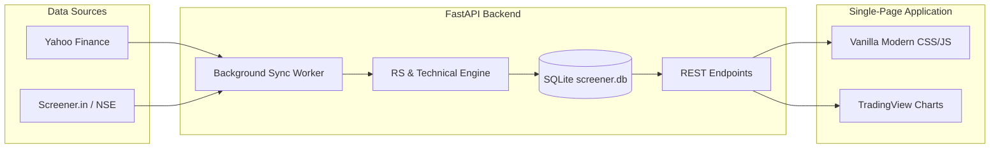

# 📈 Indian Stock Market Screener & Sector Intelligence Engine

[](https://www.python.org/)
[](https://fastapi.tiangolo.com/)
[](https://www.tradingview.com/)
[](https://www.sqlite.org/)
[](https://opensource.org/licenses/MIT)

A high-performance full-stack equity screener and sector rotation tracking engine tailored for the Indian markets (**NSE**, **BSE**, and **NSE:SME**). Designed for momentum and trend-following traders seeking institutional-quality Relative Strength (RS) ratings, technical filters, and fundamental snapshots with zero API paywalls.

---

## 🌟 Key Features

### 🎯 1. Proprietary Relative Strength (RS) Scoring
- **IBD-style 1–99 RS Percentile Rating** calculated daily against all actively traded Indian equities.
- Weighted quarterly price performance metric ($0.4 \times R_{3m} + 0.2 \times R_{6m} + 0.2 \times R_{9m} + 0.2 \times R_{12m}$).
- Instant filters for leading stocks (**RS $\ge$ 80**, **Above 50 EMA**, **Above 200 EMA**, **Within 15% of 52-Week High**, and **Volume Surge** detection).

### 🏢 2. Sector & Industry Rotation Heatmap
- Drill down across **Sectors**, **Industries**, and granular **Sub-Industries**.
- View ranked momentum over multiple timeframes: **1 Day**, **1 Week**, **1 Month**, **3 Months**, **6 Months**, and **1 Year**.
- **Screener Filter Mode**: Toggle to analyze sector performance weighted strictly by stocks that pass technical screening criteria.

### 📈 3. Institutional-Grade Technical Charts
- Powered by **TradingView Lightweight Charts v4**.
- Built-in moving averages:
  - 🔵 **50 EMA (Blue Line)** — Medium-term momentum support.
  - 🟡 **200 EMA (Yellow Line)** — Long-term trend benchmark.
- High-contrast volume histogram with dynamic surge indicators highlighting accumulation sessions ($>1.5\times$ 20-day average volume).

### 📑 4. Quarterly Financial Statements & Filing Reconciliation
- **12-Quarter Historical Table**: Net Sales, Expenses, Operating Profit, OPM %, EBITDA, Depreciation, Interest, Net Profit, and Diluted EPS.
- **Smart Filing Reconciliation**: Automatically compares standalone and consolidated disclosures to ensure recently declared results (e.g., September / Q2 filings) appear immediately even before subsidiary consolidation.

### 👥 5. Institutional Shareholding Trends
- Interactive breakdown of share ownership over recent quarters:
  - 🏛️ **Promoter Holdings**
  - 🌐 **Foreign Institutional Investors (FIIs)**
  - 🏦 **Domestic Institutional Investors (DIIs / Mutual Funds)**
  - 👥 **Public & Retail Investors** (with total shareholder counts)

### ⚡ 6. Unified Global Search & Exchange Coverage
- Fast omnisearch with debounced autocomplete.
- Full support across:
  - **NSE Mainboard Equities** (e.g., `TCS`, `HDFCBANK`, `MTARTECH`)
  - **NSE:SME Series** via automatic `-SM.NS` resolution (e.g., `PARTH`, `K2INFRA`)
  - **BSE-exclusive scrips** and scrip codes (e.g., `500002`, `BSE`)
- Offline-first **SQLite persistence**: Instant table renders and zero rate-limiting delays.

---

## 🏛️ System Architecture



---

## 🚀 Quick Start Guide

### Prerequisites
- Python 3.10 or higher
- Git

### 1. Clone the Repository
```bash
git clone https://github.com/<your-username>/nse_custom_screener.git
cd nse_custom_screener
```

### 2. Create a Virtual Environment
```bash
# Windows
python -m venv venv
.\venv\Scripts\activate

# macOS / Linux
python3 -m venv venv
source venv/bin/activate
```

### 3. Install Dependencies
```bash
pip install -r requirements.txt
```

### 4. Run the Server
```bash
python main.py
```

Open your browser at:
👉 **`http://localhost:8000`**

On startup, the server automatically boots SQLite, loads pre-computed metrics into memory for instant queries, and kicks off an asynchronous background sync for historical candles.

---

## 📂 Project Structure

```text
nse_custom_screener/
│
├── backend/
│   ├── data/
│   │   └── stock_universe.py     # Curated universe & SME/BSE ticker mappings
│   ├── database/
│   │   └── db.py                 # SQLite schema, caching, and persistence
│   ├── routers/
│   │   ├── screener.py           # Screener filters and global search API
│   │   ├── industries.py         # Sector, industry, and sub-industry analytics
│   │   ├── companies.py          # OHLCV, company overview & fundamentals
│   │   └── tracker.py            # Entry/exit watchlists & historical tracking
│   └── services/
│       ├── data_fetcher.py       # Asynchronous chunked downloader & retries
│       ├── rs_calculator.py      # Relative Strength & EMA computations
│       └── financial_service.py  # Standalone/Consolidated results & shareholding
│
├── frontend/
│   ├── css/
│   │   └── styles.css            # Responsive dark-theme dashboard UI
│   ├── js/
│   │   ├── app.js                # Router, navigation, and global search component
│   │   └── screener.js           # Tables, TradingView chart rendering & modals
│   └── index.html                # Single-page application entry
│
├── data/                         # Local database storage directory
├── main.py                       # FastAPI application entrypoint & static mount
├── requirements.txt              # Production Python dependencies
└── .gitignore                    # Git exclusions
```

---

## 📊 Technical Formulas & Definitions

| Metric | Calculation / Description |
| :--- | :--- |
| **RS Rating** | Percentile ranking (1–99) of 1-year weighted return vs. the entire market universe. |
| **50 EMA** | 50-day exponential moving average of closing prices. |
| **200 EMA** | 200-day exponential moving average (primary trend filter). |
| **Volume Surge** | Current day volume exceeding $1.5\times$ the 20-day simple average volume. |
| **From 52W High** | Percentage deviation from the rolling 252-trading-day peak price. |

---

## ⚠️ Disclaimer

*This software is developed strictly for educational, research, and personal analytical purposes. It does not constitute financial advice, investment recommendations, or SEBI-registered research. Always verify financial reports directly with the National Stock Exchange of India (NSE) or Bombay Stock Exchange (BSE) before taking investment decisions.*

---

## 📄 License

This project is licensed under the [MIT License](LICENSE).
